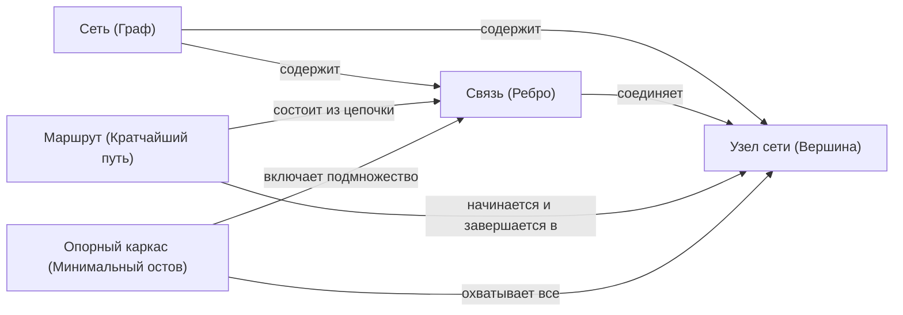
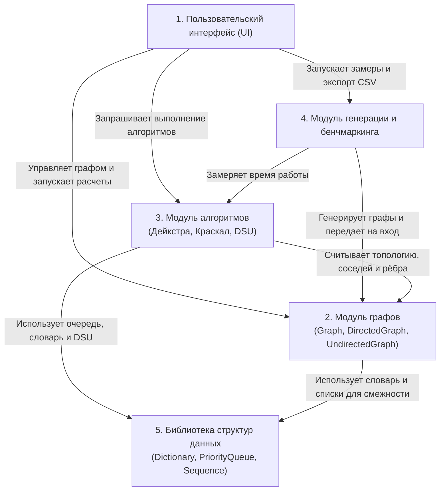

# Дизайн: Моделирование сетевых структур и алгоритмы на графах (Дейкстра и Краскал)

---

## 1. Постановка задачи

### 1.1. Что делается в работе (идея и концепция)
В работе создаётся программная система для представления, модификации и анализа сетевых структур с помощью математического аппарата теории графов. Система поддерживает два фундаментальных класса графов — **ориентированные** (связи имеют строгое направление) и **неориентированные** (связи двусторонние).

На базе созданных графовых структур реализуются два ключевых алгоритма дискретной оптимизации:
1. **Алгоритм Дейкстры:** находит кратчайший (наиболее выгодный по суммарному весу) маршрут между заданными узлами сети в условиях неотрицательных весов связей.
2. **Алгоритм Краскала:** строит минимальное остовное дерево (каркас) в неориентированной сети — минимальный по суммарной стоимости набор связей, соединяющий все узлы без образования замкнутых циклов.

Программа также включает инструменты генерации сетей произвольного размера, пользовательский интерфейс для управления графом и просмотра результатов, а также модуль бенчмаркинга для сравнительного анализа времени работы алгоритмов на одинаковых наборах данных с экспортом замеров в CSV.

### 1.2. Зачем это нужно (общий класс задач)
Графовые модели и алгоритмы поиска оптимальных связей лежат в основе широкого спектра прикладных инженерных задач:
* **Транспортная логистика и навигация:** расчёт оптимальных маршрутов доставки грузов, прокладка пути автомобильных навигаторов с учётом расстояния, пробок или стоимости проезда, в том числе по дорогам с односторонним движением (ориентированные графы) и двусторонним магистралям (неориентированные графы).
* **Проектирование инженерных и коммунальных сетей:** прокладка оптоволоконных магистралей, трубопроводов, систем электроснабжения и водоотведения. Задача состоит в том, чтобы соединить все жилые дома, подстанции или серверные узлы с минимальной суммарной стоимостью кабеля/труб без избыточных замкнутых контуров (задача о минимальном остове).
* **Маршрутизация в телекоммуникационных и компьютерных сетях:** протоколы маршрутизации пакетов (например, OSPF, IS-IS) работают на алгоритме Дейкстры для поиска быстрейшего пути прохождения пакетов, а протоколы связующего дерева (STP) предотвращают петли коммутации в Ethernet-сетях.
* **Анализ графов зависимостей:** планирование последовательности сборки программных пакетов, моделирование технологических процессов и цепочек поставок.

---

## 2. Сущности прикладной задачи

### 2.1. Описание сущностей
В контексте прикладной задачи анализа сетей выделяются следующие базовые сущности:

* **Узел сети (Пункт / Вершина):** самостоятельный объект сети, обладающий уникальным идентификатором или именем (город, распределительный центр, сервер, перекрёсток, датчик).
* **Связь (Канал / Дорога / Ребро):** физическое или логическое соединение между двумя узлами сети. Характеризуется:
  * начальным и конечным узлом;
  * направленностью (односторонняя связь в ориентированной сети или двусторонняя в неориентированной);
  * стоимостью/весом (расстояние, время проезда, цена строительства, задержка канала связи).
* **Сеть (Граф):** целостная топологическая структура, объединяющая множество узлов и соединяющих их связей. Предоставляет операции добавления, удаления узлов и связей, а также проверку их взаимного расположения.
* **Маршрут (Кратчайший путь):** непрерывная упорядоченная последовательность узлов и связей от начального пункта к целевому, обладающая минимально возможной суммарной стоимостью перехода.
* **Опорный каркас (Минимальное остовное дерево):** подмножество связей неориентированной сети, которое объединяет абсолютно все узлы сети в единую связную систему без образования замкнутых петель (циклов) и имеет наименьшую суммарную стоимость среди всех возможных вариантов объединения.

---

### 2.2. Связи между сущностями

* **Сеть** состоит из множества **Узлов сети** и соединяющих их **Связей**;
* **Связь** соединяет два конкретных **Узла сети** с заданной стоимостью;
* **Маршрут** пролегает от исходного **Узла** к целевому **Узлу** через цепочку промежуточных **Связей**;
* **Опорный каркас** охватывает все **Узлы сети**, отбирая минимально необходимый набор **Связей**.

---

## 3. Архитектура

### 3.1. Высокоуровневые компоненты системы
Система декомпозирована на 5 ключевых компонентов с четким разграничением ответственности:

1. **Пользовательский интерфейс (UI):**
   * Предоставляет рабочее пространство для ручного создания вершин и рёбер;
   * Позволяет настраивать параметры и запускать автоматическую генерацию тестовых графов;
   * Выводит списки смежности, найденные маршруты Дейкстры и структуру остова Краскала;
   * Обеспечивает запуск бенчмарков с замером времени и выгрузкой отчёта в CSV.
2. **Модуль графовых структур (`GraphModule`):**
   * *Базовый абстрактный граф (`Graph<V, W>`):* задает общий интерфейс управления вершинами, рёбрами, запроса весов и списков смежности.
   * *Ориентированный граф (`DirectedGraph<V, W>`):* реализует логику односторонних связей.
   * *Неориентированный граф (`UndirectedGraph<V, W>`):* реализует логику симметричных связей (каждое ребро связывает вершины взаимно) и фильтрацию уникальных рёбер.
3. **Модуль сетевых алгоритмов (`AlgorithmsModule`):**
   * *Алгоритм Дейкстры (`Dijkstra`):* модуль поиска кратчайшего пути от заданной вершины до целевой (или до всех остальных вершин) с контролем неотрицательности весов.
   * *Алгоритм Краскала (`Kruskal`):* модуль построения минимального остова для неориентированного графа.
   * *Система непересекающихся множеств (`DisjointSetUnion` / `DSU`):* вспомогательная структура данных, обеспечивающая алгоритму Краскала проверку принадлежности вершин одной компоненте связности за почти константное время.
4. **Модуль генерации и бенчмаркинга (`Benchmark & Generator`):**
   * Генератор случайных графов с настраиваемым числом вершин и плотностью рёбер;
   * Измеритель точного времени выполнения алгоритмов на одинаковых графах;
   * Экспорт результатов измерений в формат CSV.
5. **Библиотека базовых абстрактных структур данных (наработки ЛР-1 и ЛР-2):**
   * *Словарь (`Dictionary`):* используется для хранения списков смежности графа, карт расстояний, карт предков и дерева DSU;
   * *Очередь с приоритетами (`PriorityQueue` / `BinaryHeap`):* используется в алгоритме Дейкстры для быстрого извлечения вершины с минимальным расстоянием, а также в алгоритме Краскала для сортировки рёбер по весу;
   * *Последовательность (`Sequence` / `mutable_array_sequence`):* используется для списков смежных вершин, последовательностей узлов в маршруте и списков рёбер.

---

### 3.2. Связи между компонентами

---

### 3.3. Ключевые алгоритмические решения и проектные компромиссы

* **Представление графа через списки смежности на словаре (`Dictionary`):**
  * Для каждой вершины в словаре хранится последовательность (`mutable_array_sequence`) её исходящих соседей с весами рёбер.
  * *Обоснование:* В отличие от матрицы смежности размером $V \times V$ (которая неэффективна для разреженных сетей и требует $O(V^2)$ памяти), списки смежности требуют памяти $O(V + E)$ и позволяют алгоритму Дейкстры моментально получать только реально существующие связи текущей вершины.
* **Иерархия абстрактного графа:**
  * Базовый класс `Graph<V, W>` инкапсулирует словарь смежности и список всех вершин, предоставляя шаблонный полиморфный интерфейс.
  * Специфика добавления/удаления рёбер и получения набора всех рёбер делегируется классам-наследникам `DirectedGraph` и `UndirectedGraph`. Это исключает дублирование общего кода (управление вершинами, проверка наличия связей, подсчет элементов) и гарантирует строгое соблюдение принципа открытости/закрытости (OCP).
* **Вынесение алгоритмов из классов графа (Single Responsibility):**
  * Алгоритмы Дейкстры и Краскала не встраиваются внутрь классов графов в виде громоздких методов, а проектируются как отдельные алгоритмические модули.
  * Граф отвечает только за корректное хранение топологии сети, а алгоритмы — за оптимизационные вычисления над ней.
* **Реализация DSU на базе собственного `Dictionary`:**
  * Для предотвращения циклов в алгоритме Краскала создается класс `DisjointSetUnion<V>`, использующий два словаря: `Dictionary<V, V> parent` (для хранения представителей компонент) и `Dictionary<V, int> rank` (для балансировки глубины деревьев).
  * Реализуются две классические эвристики: **сжатие путей** (path compression при поиске представителя) и **объединение по рангу** (union by rank). Это дает амортизированную сложность операций почти $O(1)$.
* **Очередь с приоритетами для Дейкстры:**
  * Использование собственной `PriorityQueue` (на базе двоичной min-кучи) для хранения пар `(вершина, текущее_расстояние)` позволяет снизить временную сложность алгоритма Дейкстры до классических $O((V + E) \log V)$ без использования сторонних STL-контейнеров.

---

## 4. Функциональные требования

* **К Узлу (Вершине):**
  * Идентифицироваться уникальным значением произвольного типа (поддержка чисел, строк и составных структур при наличии операций сравнения).
  * *Граничный случай:* попытка добавить в сеть вершину с уже существующим идентификатором должна возвращать `false` без изменения внутренней структуры сети.

* **К Связи (Ребру):**
  * Связывать две вершины (начальную и конечную) и содержать числовой вес (стоимость, расстояние).
  * *Граничный случай:* если вес ребра отрицателен ($w < 0$), алгоритм Дейкстры должен прерывать работу и сигнализировать об ошибке (выбрасывать исключение), так как классический алгоритм Дейкстры не применим для графов с отрицательными весами.
  * *Особый сценарий:* ребро-петля (связь вершины самой с собой $(u \to u)$). Система должна корректно поддерживать петли, не вызывая зацикливания алгоритмов обхода.

* **К Ориентированному графу (`DirectedGraph`):**
  * Добавление ребра из $u$ в $v$ создаёт строго однонаправленную связь $u \to v$.
  * Удаление ребра $u \to v$ не должно затрагивать обратное ребро $v \to u$ (если оно существовало).
  * Метод выгрузки списка рёбер `get_edges()` возвращает все направленные дуги графа.

* **К Неориентированному графу (`UndirectedGraph`):**
  * Добавление ребра между $u$ и $v$ создаёт взаимную связь: переход из $u$ в $v$ и переход из $v$ в $u$ с одинаковым весом.
  * Удаление ребра между $u$ и $v$ удаляет связь в обоих направлениях синхронно и уменьшает общий счётчик рёбер графа ровно на единицу.
  * Метод выгрузки списка рёбер `get_edges()` возвращает каждое неориентированное ребро ровно один раз (без дублирования зеркальных пар $(u, v)$ и $(v, u)$), что критически важно для корректной сортировки в алгоритме Краскала.

* **К Общим операциям графа (`Graph`):**
  * `add_vertex(v)` — добавление новой вершины.
  * `remove_vertex(v)` — удаление вершины и автоматическое удаление всех входящих и исходящих из неё рёбер с корректным пересчётом счётчика рёбер.
  * `contains_vertex(v)`, `contains_edge(u, v)` — предикаты проверки наличия элементов.
  * `get_edge_weight(u, v)` — возврат веса ребра (генерация исключения, если ребро отсутствует).
  * `get_neighbors(u)` — возврат списка всех смежных с $u$ вершин с весами связей.
  * `get_vertices()` — возврат списка всех вершин сети.
  * `get_vertex_count()`, `get_edge_count()`, `is_empty()`, `clear()` — информационные методы и полная очистка сети.

* **К Алгоритму Дейкстры (`Dijkstra`):**
  * Принимать граф, начальную вершину и целевую вершину (либо рассчитывать расстояния до всех вершин сети).
  * Находить кратчайший путь, возвращая статус достижения, суммарный вес пути и упорядоченную цепочку вершин от старта до финиша.
  * *Граничный случай (цель недостижима):* если между стартом и финишем нет пути (разные компоненты связности), алгоритм возвращает флаг `found = false` с пустым путем.
  * *Граничный случай (старт совпадает с финишем):* длина пути равна $0$, путь состоит из одной начальной вершины.
  * *Граничный случай (несуществующая вершина):* генерация понятной ошибки валидации (`std::invalid_argument`).
  * *Особый сценарий (отрицательные веса):* при наличии хотя бы одного ребра с весом $< 0$ выбрасывать исключение с предупреждением о неприменимости алгоритма.

* **К Алгоритму Краскала (`Kruskal`):**
  * Принимать неориентированный граф.
  * Формировать остовное дерево, возвращая результирующий граф (или список остовных рёбер), суммарный вес дерева и признак полной связности.
  * *Особый сценарий (ориентированный граф):* алгоритм Краскала предназначен строго для неориентированных графов. При попытке передачи орграфа система должна отклонять операцию на уровне типов либо генерировать исключение.
  * *Особый сценарий (несвязный граф):* если исходная сеть разбита на несколько изолированных фрагментов, алгоритм строит минимальный остовный лес (spanning forest), объединяющий узлы внутри каждой отдельной компоненты, и сигнализирует о несвязности всей сети.
  * *Граничный случай (пустой граф или граф без рёбер):* остовное дерево содержит 0 рёбер, суммарный вес равен $0$.

* **К Пользовательскому интерфейсу:**
  * Предоставлять интерактивные таблицы для ручного ввода и редактирования узлов и связей сети.
  * Предоставлять панель генератора для быстрого создания графов со случайной топологией (задание количества вершин и плотности рёбер).
  * Отображать результаты работы алгоритмов в структурированном виде:
    * Для Дейкстры: длина маршрута и цепочка вершин;
    * Для Краскала: список включённых в остов рёбер, суммарный вес остова, число компонент.
  * Содержать вкладку бенчмарка: проведение замеров времени работы алгоритмов при постепенном увеличении размера сети ($N = 10, 50, 100, 250, 500 \dots$), построение сводной таблицы времени и экспорт данных в CSV-файл для внешнего анализа.
  * Осуществлять валидацию пользовательского ввода (запрет пустых имён, некорректных числовых значений, отрицательных весов).
