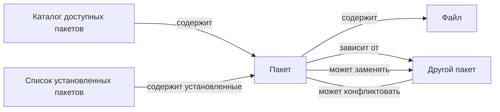
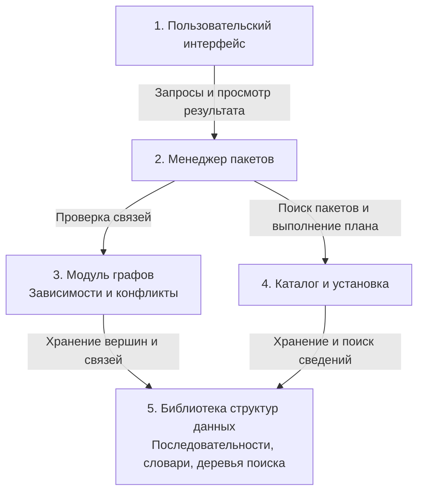

# Дизайн: Менеджер пакетов

---

## 1. Постановка задачи

### 1.1. Что делается в работе (идея и концепция)

**Пакет** — упакованная и укомплектованная часть программного обеспечения. Обычно он включает исполняемые и вспомогательные файлы, но в общем случае может быть просто набором файлов (артефактов) с дополнительной информацией — метаданными. При этом пакет не обязательно работает сам по себе: ему могут требоваться другие пакеты.

К метаданным пакета относятся:

* **Версия** пакета.
* **Связь с другими версиями и пакетами:** например, один пакет может заменять другой пакет определённой версии.
* **Зависимости:** какие другие пакеты нужны для его работы.
* **Схема разворачивания:** какие файлы и в какие места файловой системы нужно поместить при установке.
* **Скрипты:** команды, которые необходимо выполнить до и/или после установки пакета.

**Цель программы** — разработать прототип менеджера пакетов, который позволяет устанавливать, удалять и заменять пакеты с учётом их зависимостей, не нарушая работу уже установленных программ.

**Задачи, решаемые менеджером пакетов:**

* Построение **графа зависимостей** выбранного пакета и проверка наличия всех необходимых зависимостей.
* Установка пакета при условии, что необходимые зависимости удовлетворены, включая выполнение установочных скриптов.
* Поиск пакета, подходящего под заданные требования к зависимости (например, к версии).
* Сохранение целостности системы:
  * не допускать дублирования установленных пакетов;
  * не устанавливать пакет, если его зависимости не удовлетворены;
  * не нарушать работу уже установленных пакетов — например, не удалять нужные им зависимости при замене другого пакета.

### 1.2. Зачем это нужно (общий класс задач)

Программа решает задачу **управления программными пакетами с учётом их зависимостей**. Такие задачи встречаются в менеджерах пакетов операционных систем (`apt`, `brew`), средствах установки библиотек (`pip`) и при развёртывании программ.

Менеджер избавляет пользователя от необходимости вручную разбираться в длинных цепочках зависимостей и помогает избегать ошибок при установке и удалении.

---

## 2. Сущности прикладной задачи

### 2.1. Описание сущностей

В задаче есть 4 основные сущности:

* **Пакет:** набор файлов и метаданных, подготовленный для установки. Имеет название, версию, зависимости, правила установки и сведения о замене других пакетов.
* **Файл:** отдельный файл, входящий в пакет. Имеет название, содержимое и путь, по которому его нужно разместить при установке.
* **Каталог доступных пакетов:** набор пакетов, которые можно установить. Содержит сведения о доступных версиях.
* **Список установленных пакетов:** набор пакетов, уже установленных в системе. Позволяет проверить, что установлено сейчас.

### 2.2. Связи между сущностями

* **Каталог доступных пакетов** содержит **Пакеты**, доступные для установки.
* **Список установленных пакетов** содержит **Пакеты**, которые уже установлены.
* **Пакет** содержит **Файлы**.
* **Пакет** может **зависеть от** другого пакета с определённой версией, **заменять** другой пакет или **конфликтовать** с ним. Конфликт действует в обе стороны.

---

## 3. Архитектура

### 3.1. Основные компоненты системы

Система состоит из 5 компонентов:

1. **Пользовательский интерфейс:** позволяет просматривать каталог, добавлять пакеты и версии, запускать установку и удаление, видеть ошибки и результаты проверки.
2. **Менеджер пакетов:** основная логика. Подбирает версии, проверяет зависимости и конфликты, составляет план установки или удаления.
3. **Модуль графов:** представляет связи между пакетами и помогает их проверять:
   * **Ориентированный граф** хранит зависимости: если `A` требует `B`, связь идёт от `A` к `B`.
   * **Неориентированный граф** хранит конфликты: если `A` несовместим с `B`, то и `B` несовместим с `A`.
4. **Каталог и установка:** хранят сведения о доступных и установленных пакетах, размещают файлы и выполняют разрешённые установочные действия в отдельной папке.
5. **Библиотека структур данных:** предоставляет универсальные средства для хранения и поиска информации:
   * **Последовательности** — для хранения списков пакетов, файлов.
   * **Словари** — для поиска пакетов и доступа к данным графов.
   * **Деревья поиска** — для организации хранения элементов в словарях.

### 3.2. Связи между компонентами

### 3.3. Ключевые решения и алгоритмы

* **Проверка зависимостей.** Для выбранной версии программа находит все необходимые пакеты, включая зависимости зависимостей. Для каждой зависимости подбирается версия, подходящая под её требования. Если подходящей версии нет, установка не начинается.
* **Порядок установки.** Зависимости образуют ориентированный граф. Для их поиска и определения порядка установки используется обход в глубину (DFS): каждый пакет добавляется в план только после обработки всех его зависимостей. Если обнаружен цикл зависимостей, установка отклоняется.
* **Проверка конфликтов.** Перед установкой программа проверяет неориентированный граф несовместимостей. Конфликтующие версии нельзя установить вместе.
* **Удаление и замена.** Перед удалением программа проверяет, не требуется ли пакет другим установленным программам. Замена разрешается, только если новые версии продолжают удовлетворять их зависимостям.
* **Сохранение целостности.** Сначала строится и проверяется полный план. Только после этого меняются файлы и список установленных пакетов. Если установка или установочное действие завершилось ошибкой, изменения в управляемой папке отменяются.
* **Хранение данных.** Графы представлены списками смежности: для каждого пакета хранится список связанных с ним пакетов. Для этого используется словарь (`Dictionary`). Словари могут опираться на обычные деревья поиска (`BST`) или сбалансированные деревья (`AVL`), что позволяет сравнивать скорость поиска.

---

## 4. Функциональные требования

* **К каталогу и пакетам:**
  * Хранить название пакета, его версии, файлы, зависимости, замены и установочные действия.
  * Позволять добавлять, просматривать и искать пакеты по имени и требованиям к версии.
  * Не допускать двух одинаковых записей одной версии пакета.
  * *Граничный случай:* если подходящей версии нет, сообщать об этом.

* **К модулю графов:**
  * Поддерживать ориентированные и неориентированные графы, добавление и удаление вершин и связей, просмотр соседних вершин.
  * Строить граф зависимостей выбранных версий и находить все нужные зависимости.
  * Определять порядок установки с помощью DFS.
  * Проверять отсутствие циклов зависимостей и несовместимых пакетов.
  * *Особый сценарий:* одна библиотека может требоваться нескольким пакетам, но устанавливается только один раз.

* **К установке, удалению и замене:**
  * Перед установкой проверять все зависимости, подходящие версии и конфликты.
  * Показывать план действий и выполнять его в правильном порядке.
  * Размещать файлы по правилам пакета и выполнять предусмотренные действия до и после установки.
  * Не устанавливать повторно уже установленную подходящую версию.
  * Запрещать удаление или замену пакета, если из-за этого перестанут работать другие установленные пакеты.
  * *Особый сценарий:* если в зависимостях есть цикл, нужная версия отсутствует или пакеты конфликтуют, операция не выполняется.
  * *Особый сценарий:* при ошибке во время установки прежнее состояние управляемых файлов и списка пакетов восстанавливается.

* **К пользовательскому интерфейсу и проверке работы:**
  * Показывать доступные и установленные пакеты, их версии, зависимости и конфликты.
  * Позволять задавать исходные данные вручную и автоматически создавать тестовые наборы пакетов.
  * Показывать найденные зависимости, порядок установки и причины отказа.
  * Измерять время поиска зависимостей и построения порядка установки на графах разного размера.
  * Сохранять результаты измерений в CSV.
  * *Граничный случай:* пустой каталог, отсутствующий пакет или некорректная версия должны обрабатываться понятным сообщением, без сбоя программы.
