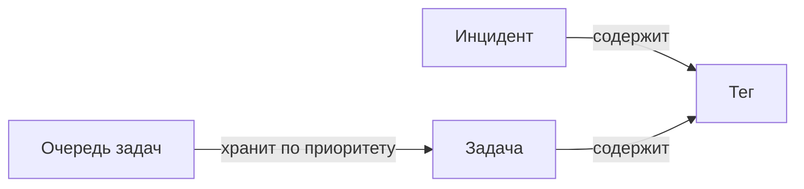
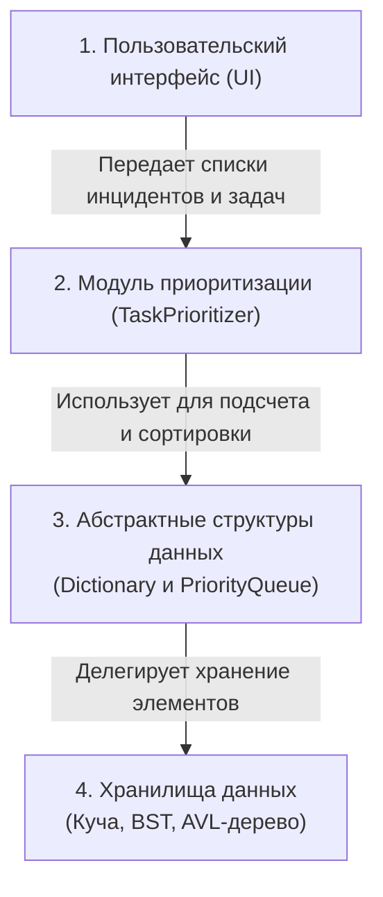

# Дизайн: Приоритизация задач по инцидентам

---

## 1. Постановка задачи

### 1.1. Что делается в работе (идея и концепция)
У нас есть список задач и список произошедших аварий или багов (инцидентов). 

У каждого инцидента есть:
* название;
* важность (число от 0 и выше — чем больше, тем серьезнее авария);
* набор тегов (метки компонентов, например: `сеть`, `база данных`, `авторизация`).

У каждой задачи также есть название и набор тегов тех компонентов, которые она затрагивает.

**Цель программы** — автоматически расставить задачи по порядку важности:
1. Посчитать суммарный вес каждого тега по всем инцидентам: сложить важность тех инцидентов, где этот тег встретился. Чем чаще тег упоминается в тяжелых сбоях, тем он важнее.
2. Посчитать приоритет каждой задачи: сложить веса всех её тегов.
3. Поместить задачи в очередь с приоритетом, чтобы инженер в первую очередь брал в работу те задачи, которые чинят наиболее проблемные места системы.

### 1.2. Зачем это нужно (общий класс задач)
Программа решает задачу **автоматического распределения ресурсов и планирования работ на основе статистики сбоев**:
* **Техподдержка (Service Desk):** когда в бэклоге сотни задач, система помогает сразу увидеть задачи, закрывающие самые частые и болезненные поломки пользователей.
* **Информационная безопасность:** выбор задач по закрытию уязвимостей в зависимости от того, какие подсистемы чаще всего атакуют.
* **Обслуживание оборудования:** планирование ремонтов тех узлов и агрегатов, по которым чаще всего приходят аварийные сигналы с датчиков.

---

## 2. Сущности прикладной задачи

### 2.1. Описание сущностей
В прикладной задаче есть 4 сущности:

* **Инцидент:** произошедший сбой или ошибка. Содержит поля: название, важность (критичность сбоя $\ge 0$) и список тегов.
* **Тег:** текстовая метка компонента или подсистемы (`network`, `auth`, `database`), связывающая инциденты и задачи. Содержит поля: название и рассчитанный вес (суммарная важность инцидентов, где он встретился).
* **Задача:** работа, которую необходимо выполнить. Содержит поля: название, список тегов, исходный порядковый номер при создании и вычисленный суммарный приоритет.
* **Очередь задач:** список задач, упорядоченный по убыванию их приоритета.

---

### 2.2. Связи между сущностями

* **Инцидент** содержит **Теги**;
* **Задача** содержит **Теги**;
* **Очередь задач** хранит по приоритету **Задачи**.

---

## 3. Архитектура

### 3.1. Высокоуровневые компоненты системы
Система состоит из 4 основных компонентов:

1. **Пользовательский интерфейс (UI):** графическое окно на Qt6 для ввода данных вручную, случайной генерации задач и инцидентов, просмотра результатов и запуска тестов скорости (бенчмарка).
2. **Модуль приоритизации (`TaskPrioritizer`):** главный класс логики. Принимает списки инцидентов и задач, считает веса тегов, вычисляет приоритеты задач и заполняет очередь.
3. **Абстрактные структуры данных:**
   * *Словарь (`Dictionary`):* хранит пары «тег $\to$ вес» для быстрого поиска веса по имени тега.
   * *Очередь с приоритетом (`PriorityQueue`):* принимает задачи и выдает их строго по убыванию приоритета.
4. **Хранилища данных:** конкретные реализации структур, которые можно свободно переключать:
   * *Двоичная куча (`Heap`)*;
   * *Двоичное дерево поиска (`BST`)*;
   * *Сбалансированное AVL-дерево (`AVL`)*.

---

### 3.2. Связи между компонентами

---

### 3.3. Ключевые алгоритмические решения и проектные компромиссы

* **Двухэтапный алгоритм расчета:**
  1. *Этап 1 (Подсчет весов тегов):* проходим по всем инцидентам. Для каждого уникального тега инцидента прибавляем важность инцидента в словарь. Если тега еще нет в словаре — создаем запись.
  2. *Этап 2 (Расчет приоритетов задач):* проходим по всем задачам. Для каждого тега задачи берем его вес из словаря и суммируем. Создаем задачу с итоговым приоритетом и кладем ее в очередь с приоритетом.
* **Разрешение одинаковых приоритетов:**
  Если у двух задач получился одинаковый приоритет, первой из очереди выйдет та задача, которая была добавлена в систему раньше (у которой меньше исходный индекс `task_index`). Это дает предсказуемый результат и защищает старые задачи от зависания в очереди.
* **Защита от повторов тегов:**
  Если в одном инциденте или в одной задаче тег продублирован (например, `["сеть", "сеть"]`), алгоритм учитывает его только один раз, чтобы не завышать приоритет по ошибке.
* **Сменные хранилища данных:**
  Модуль приоритизации не зависит от конкретной реализации деревьев или кучи. И для словаря, и для очереди тип хранилища (Куча / BST / AVL) передается при создании, что позволяет тестировать и сравнивать производительность всех 9 комбинаций.

---

## 4. Функциональные требования

* **К Инциденту:**
  * Хранить название, числовую важность и список тегов.
  * *Граничный случай:* важность инцидента не может быть отрицательной ($p < 0$).
  * *Граничный случай:* тег не может быть пустой строкой.
  * *Особый сценарий:* если внутри одного инцидента тег указан повторно (например, `["сеть", "сеть"]`), его важность учитывается в весе данного тега только один раз.

* **К Задаче:**
  * Хранить название, список тегов и исходный порядковый номер добавления в систему.
  * *Особый сценарий:* если внутри одной задачи тег продублирован, его вес прибавляется к приоритету задачи ровно один раз.

* **К Модулю приоритизации (`TaskPrioritizer`):**
  * Принимать входные списки инцидентов и задач (с созданием независимых копий данных) и настраивать типы хранилищ (Куча, BST, AVL) отдельно для словаря и очереди.
  * Запускать расчет приоритетов по вызову метода `prioritize()`.
  * Предоставлять методы работы с результатом:
    * `top()` — просмотр задачи с наибольшим приоритетом без удаления;
    * `pop()` — извлечение задачи с наибольшим приоритетом из очереди;
    * `empty()` — проверка очереди на пустоту;
    * `get_tag_priorities()` — получение словаря с рассчитанными весами тегов.
  * Замерять время выполнения отдельно для этапа подсчета тегов и для этапа построения очереди.
  * *Граничный случай (пустой список инцидентов):* словарь тегов пуст, все задачи получают приоритет 0 и выстраиваются строго по исходному порядку добавления.
  * *Граничный случай (пустой список задач):* веса тегов рассчитываются штатно, очередь задач пуста (`empty() == true`), а вызов `pop()` на пустой очереди генерирует ошибку.
  * *Особый сценарий (непересекающиеся теги):* если теги задач не встречаются в инцидентах, все задачи получают приоритет 0 и упорядочиваются по порядку добавления.
  * *Особый сценарий (одинаковый приоритет):* если у двух задач совпал рассчитанный приоритет, первой из очереди гарантированно извлекается задача, добавленная раньше (с меньшим индексом).

* **К Пользовательскому интерфейсу:**
  * Предоставлять таблицы для просмотра и ручного редактирования инцидентов и задач.
  * Поддерживать случайную генерацию тестовых данных с настройкой количества элементов.
  * Позволять выбирать типы хранилищ (Куча, BST, AVL) для словаря и очереди через выпадающие списки.
  * Отображать результаты: таблицу весов тегов и упорядоченный список задач с их приоритетами.
  * Предоставлять панель бенчмарка: запуск замеров времени в фоновом режиме с индикатором прогресса и возможностью экспорта результатов в CSV.
  * *Особый сценарий:* при некорректном вводе данных (отрицательные числа, пустые теги) выводить пользователю сообщение об ошибке и не допускать запуск расчета.
